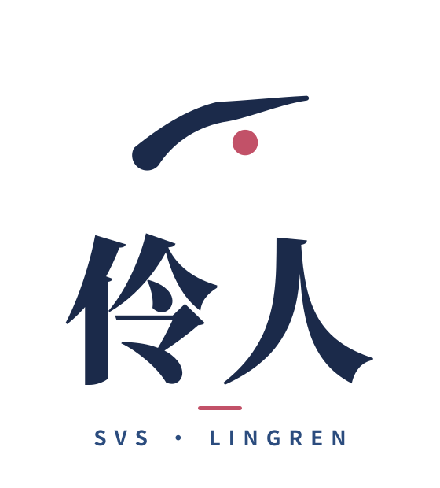

# 伶人 Lingren

  

独立歌声合成（SVS）API 服务，供夜半（Yeban）调用。

同一套 FastAPI 服务，三种部署：本地 macOS、Colab 远端、Docker Linux GPU。

- 默认模型：SoulX-Singer（乐谱时钟严格跟乐谱，Apache-2.0）
- 音质选项：VocalRender（48kHz，Apache-2.0，须 prompt 音频，时值由模型自定，服务回执实测起点贴轨）
- 作业 API：`parts × takes`（多遍录音叠厚度、多声部和声）；批量差异门保证每遍不完全相同
- Yeban 侧：两个 MCP 工具（`synthesize_singing`、`svs_job`），合成出的是普通录音片段，走现有音频片段机制

English version: [README_EN.md](README_EN.md).

## 文档

- 设计：[RESEARCH-AND-DESIGN.md](RESEARCH-AND-DESIGN.md)
- Phase 0 实测：[phase0/REPORT.md](phase0/REPORT.md)（Colab L4 两模型官方 demo，选型成立）
- Phase 1：[phase1/REPORT.md](phase1/REPORT.md)（补丁验证＋服务骨架＋SoulX 适配器＋作业 API）
- Phase 2：[phase2/REPORT.md](phase2/REPORT.md)（VR 适配器接线＋Yeban 工具本体＋长乐句再验＋prompt 流水线）
- 品牌手册：[branding/brand-manual.html](branding/brand-manual.html)

## 状态

Phase 0／1／2 已完成并实测。待办：Mac MPS 实测（触发条件：SoulX 的 MPS RTF > 2 则启动 MLX 二期）、命名 tunnel（需登录账号与 zone 定夺）、Docker 镜像在 Linux GPU 机上构建、Yeban 工具与真实服务 E2E。

## 品牌

一道弧线，一点胭脂。弧线是丹凤眼尾的一挑，也是水袖收势的出锋，藏锋起笔、出锋微扬；胭脂一点落在黄金分割，是绛唇，也是数据流中的焦点。

| 横版组合 | 竖版组合 |
| --- | --- |
|  |  |

| 标志 | 字标 | 应用图标 |
| --- | --- | --- |
|  |  |  |

| 徽章 | 反白标志 |
| --- | --- |
|  |  |

配色：靛墨 `#1B2A4A`、靛蓝 `#2B4C7E`、胭脂 `#C25168`、纸 `#F7F4EC`。全套文件见 [branding/](branding/)（标志、横版、竖版、单色、反白、字标、徽章、应用图标、favicon）。

## 许可

本仓库自有内容采用 MIT 协议，见 [LICENSE](LICENSE)。代码与权重许可各从其源：SoulX-Singer 与 VocalRender 均为 Apache-2.0，详见设计文档 §10。
