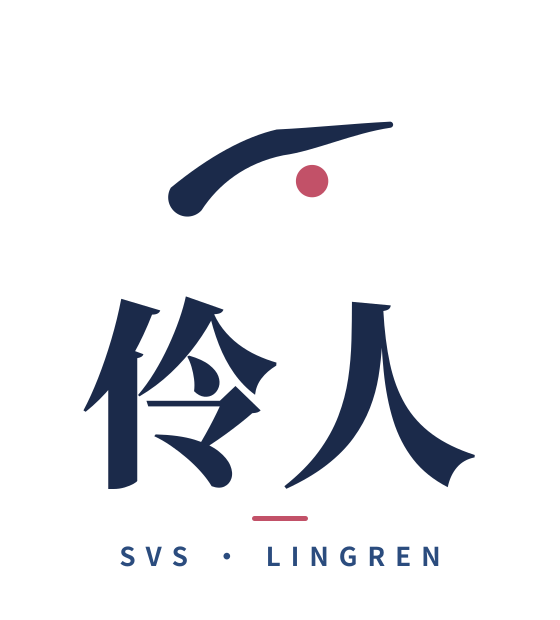
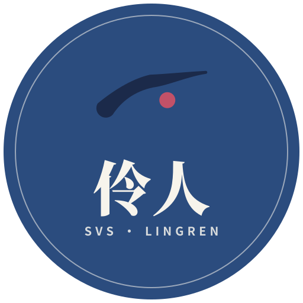

# Lingren

  

A standalone singing voice synthesis (SVS) API service, called by Yeban.

One FastAPI codebase, three deployments: local macOS, remote Colab, Docker on Linux GPU.

- Default model: SoulX-Singer (strict score-clock follower, Apache-2.0)
- Quality option: VocalRender (48kHz, Apache-2.0, requires prompt audio; timing is model-decided, the service receipt reports measured onsets for placement)
- Job API: `parts × takes` (multi-take stacking for thickness, multi-part harmony); a batch difference gate guarantees takes are never identical
- Yeban side: two MCP tools (`synthesize_singing`, `svs_job`); synthesized output is an ordinary recorded clip, imported through the existing audio-clip mechanism

中文版：[README.md](README.md).

## Documents

- Design: [RESEARCH-AND-DESIGN.md](RESEARCH-AND-DESIGN.md)
- Phase 0 measurements: [phase0/REPORT.md](phase0/REPORT.md) (official demos of both models on Colab L4; model selection confirmed)
- Phase 1: [phase1/REPORT.md](phase1/REPORT.md) (patch verification + service skeleton + SoulX adapter + job API)
- Phase 2: [phase2/REPORT.md](phase2/REPORT.md) (VocalRender adapter wiring + Yeban tool bodies + long-phrase re-verification + prompt pipeline)
- Brand manual: [branding/brand-manual.html](branding/brand-manual.html)

## Status

Phases 0, 1 and 2 are complete and measured. Remaining: Mac MPS measurement (trigger: if SoulX MPS RTF > 2, start the MLX phase-2 port), named tunnel (login account and zone to be decided), Docker image build on a Linux GPU machine, Yeban tools ↔ live service end-to-end test.

## Brand

One sweeping stroke, one rouge dot. The stroke is the flick of a phoenix eye's tail and the edge of a water sleeve — a reserved entry, a rising exit; the rouge dot sits at the golden ratio, a painted lip and the focal point of the data stream.

| Horizontal lockup | Vertical lockup |
| --- | --- |
|  |  |

| Mark | Wordmark | App icon |
| --- | --- | --- |
|  |  |  |

| Badge | Reversed mark |
| --- | --- |
|  |  |

Palette: ink indigo `#1B2A4A`, indigo `#2B4C7E`, rouge `#C25168`, paper `#F7F4EC`. Full set in [branding/](branding/) (mark, horizontal, vertical, mono, reversed, wordmark, badge, app icon, favicon).

## License

This repository's own content is MIT licensed, see [LICENSE](LICENSE). Model code and weights follow their own licenses: SoulX-Singer and VocalRender are both Apache-2.0, see §10 of the design document.
